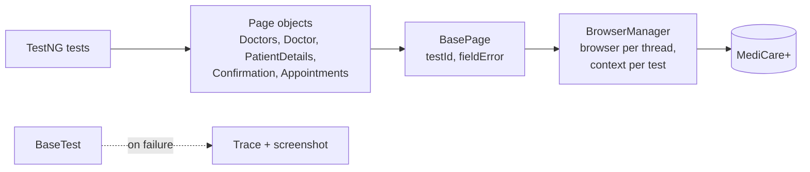

<div align="center">

# 🩺 Playwright (Java) + TestNG UI Framework

**Parallel UI tests for MediCare+ appointments, with Playwright for Java and TestNG**

   

[](https://github.com/skamirullah/practiceqa-playwright-testng-ui/actions/workflows/ci.yml)  

[What it tests](#-what-it-tests) · [Quick start](#-quick-start) · [How it is built](#-how-it-is-built) · [Structure](#-project-structure) · [Reports](#-reports-and-debugging)

</div>

---

## 👋 Overview

A UI automation framework that uses Playwright's Java API with TestNG. It books doctor appointments as new and existing patients, checks fees and validation, and cancels bookings, with tests running in parallel.

|  |  |
|---|---|
| **App under test** | [MediCare+](https://www.practiceqaautomation.com/apps/clinic), a clinic app for finding doctors and booking appointments |
| **Kind of testing** | UI, test-driven (TDD) style with TestNG |
| **Tests** | 17 tests |
| **Runs in** | Chromium, Firefox or WebKit |

### Highlights

- **Thread-safe Playwright.** One browser per thread and a fresh context per test.
- **Web-first assertions.** `assertThat(locator)` retries, so there are no manual waits.
- **Trace on failure.** A failed test saves a Playwright trace and attaches a screenshot to Allure.
- **Data-driven.** One test covers all five specialties through a data provider.

## 🎯 What it tests

| Area | What is checked |
|---|---|
| Doctor directory | All doctors listed; each specialty filter shows only its doctors; the filter toggles off |
| Slots | A slot is required before continuing |
| New patient | Books a video consultation and gets an appointment ID |
| Existing patient | Found by patient ID, books an in-clinic visit |
| Fees | A video consult costs 80% of the in-clinic fee |
| Managing appointments | Shown as upcoming, can be cancelled, and Keep leaves it unchanged |
| Form validation | Patient type, every new-patient field, symptoms length, unknown patient ID |

## 🚀 Quick start

**You need:** Java 17+ and Maven 3.9+. Playwright downloads its browser on the first run.

```bash
git clone https://github.com/skamirullah/practiceqa-playwright-testng-ui.git
cd practiceqa-playwright-testng-ui
mvn test
```

| Command | What it does |
|---|---|
| `mvn test` | Run the full regression suite in parallel |
| `mvn test -Dsuite=testng-smoke.xml` | Run only the smoke tests |
| `mvn test -Dbrowser=firefox` | Run in Firefox (or `webkit`) |
| `mvn test -Dheadless=false -Dslow.mo=300` | Watch the browser, slowed down |
| `mvn allure:serve` | Open the Allure report |

## 🧱 How it is built



- **`BrowserManager` with ThreadLocals.** Playwright objects are not thread-safe, so each thread owns its own Playwright, browser, context and page.
- **Context per test, browser per thread.** Tests are isolated without paying for a new browser each time.
- **Page objects return `Locator`s.** Tests assert with `PlaywrightAssertions`, which wait for the expected state.
- **Fluent flows.** `cardiologist().chooseType("video").pickFirstAvailableSlot().continueToDetails()`.
- **Records for data.** `Patient.valid()` and `Patient.blank()` drive positive and negative cases.

## 📁 Project structure

```text
src
├── main/java/com/practiceqa/medicare
│   ├── browser/BrowserManager.java # Playwright lifecycle, thread-safe
│   ├── config/Config.java          # settings from -D flags, env vars, then config.properties
│   ├── pages/                      # BasePage, DoctorsPage, DoctorPage, PatientDetailsPage,
│   │                               # ConfirmationPage, AppointmentsPage
│   └── data/                       # Patient, Clinic
└── test
    ├── java/com/practiceqa/medicare
    │   ├── base/BaseTest.java      # context per test, trace and screenshot on failure
    │   └── tests/                  # DoctorSearch, Booking, PatientFormValidation
    └── resources/config.properties
testng.xml                          # full regression, parallel
testng-smoke.xml                    # smoke group only
```

## ⚙️ Configuration

Defaults live in `src/test/resources/config.properties`. Override any of them on the command line (`-Dbrowser=firefox`) or with an environment variable (`BROWSER=firefox`); nothing needs editing to change environment.

| Setting | Default | What it does |
|---|---|---|
| `base.url` | the live site | Site to test. Point it at a local or staging build. |
| `browser` | `chromium` | `chromium`, `firefox` or `webkit`. |
| `headless` | `true` | Set to `false` to watch the browser. |
| `slow.mo` | `0` | Milliseconds to pause between actions in a headed run. |
| `timeout` | `10000` | Milliseconds an action or assertion waits before failing. |

## 📊 Reports and debugging

- **Allure**: run `mvn allure:serve` after a test run for a report with steps, timings and attachments.
- **Traces**: a failed test writes `target/traces/<test>.zip`. Open it at [trace.playwright.dev](https://trace.playwright.dev) to step through the run.
- **Screenshots** of failures are attached to the Allure report.

## 🔁 Continuous integration

[GitHub Actions](.github/workflows/ci.yml) installs the browser, runs the suite on every push and pull request, and can be started by hand for Firefox or WebKit. Results and traces are uploaded.

## 🧪 About the app under test

MediCare+ lists doctors by specialty, offers in-clinic and video consultations, shows which time slots are free, and keeps a list of appointments that can be rescheduled or cancelled.

[PracticeQAAutomation](https://www.practiceqaautomation.com) is a free practice site for QA engineers, with realistic apps to automate with Selenium, Playwright and Cypress. All data in these tests is fictional.

## 👤 Author

**Sk Amir Ullah** · Technical Lead, SDET and Test Automation

[Portfolio](https://skamirullah.com) · [LinkedIn](https://linkedin.com/in/skamirullah) · [GitHub](https://github.com/skamirullah) · [PracticeQAAutomation](https://www.practiceqaautomation.com)

## 📄 License

[MIT](LICENSE)
